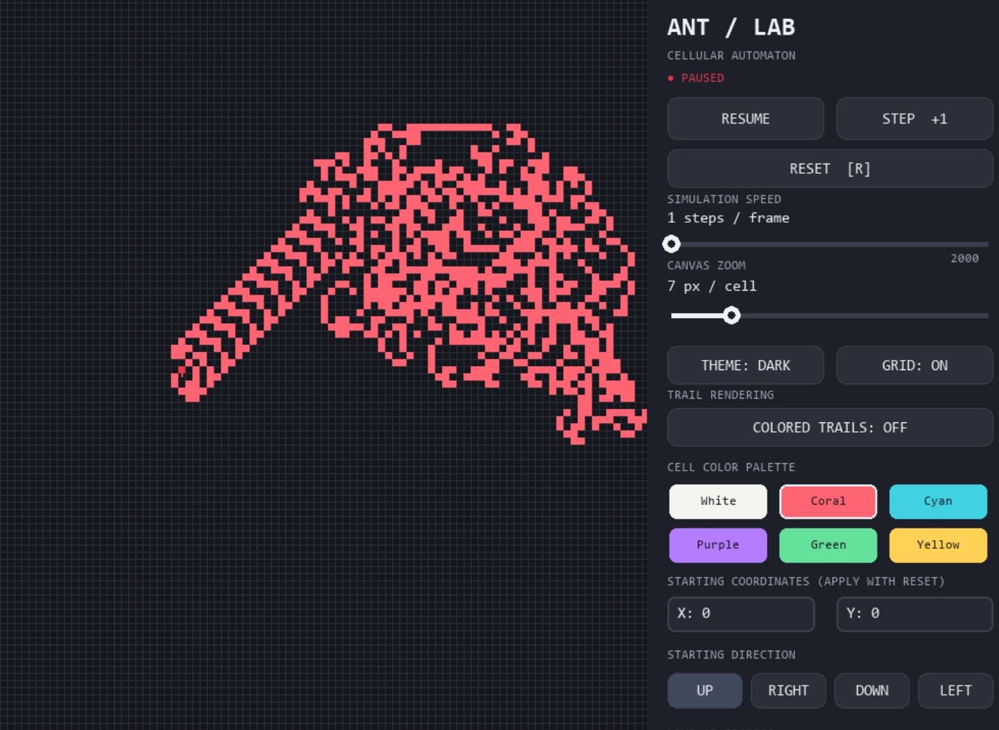

# ANT / LAB — Langton's Ant

A minimalist, interactive **Langton's Ant simulator** built with Python and Pygame. Explore how a simple set of movement rules can generate complex patterns from an initially empty grid.

## Features

- **Real-time simulation** with pause, resume, reset, and single-step controls.
- **Adjustable speed** from 1 to 2,000 steps per frame.
- **Zoom control** to inspect individual cells or larger patterns.
- **Light and dark themes** with six color options for each theme.
- **Black-and-white or colored trails** for different visualizations.
- **Custom starting coordinates** and initial direction.
- **Live statistics** showing step count, black cell count, and ant coordinates.
- **Grid toggle** for easier visualization.
- **Responsive, resizable window** with a dedicated control panel.

## About Langton's Ant

Langton's Ant is a cellular automaton operating on a square grid. The ant follows two simple rules:

1. If the current cell is white, turn right, flip the cell to black, and move forward.
2. If the current cell is black, turn left, flip the cell to white, and move forward.

Despite these simple rules, the system produces complex patterns and eventually forms a recognizable highway under standard conditions.

## Demo Image



## Requirements

- Python 3.10 or later
- Pygame

## Installation

1. Clone the repository:

   ```bash
   git clone <www.github.com/sudopriyal/langtons-ant-sim>
   cd <langtons-ant-sim>
   ```

2. Create and activate a virtual environment (recommended):

   **Windows — PowerShell**
   ```powershell
   python -m venv .venv
   .\.venv\Scripts\Activate.ps1
   ```

   **macOS / Linux**
   ```bash
   python3 -m venv .venv
   source .venv/bin/activate
   ```

3. Install Pygame:

   ```bash
   python -m pip install pygame
   ```

## Run the Application

Run the Python file containing the simulation:

```bash
python langtons_ant.py
```

## Controls

| Control | Action |
|---|---|
| Resume / Pause | Start or pause the simulation |
| Step +1 | Advance by one step |
| Reset | Restart from the configured starting position |
| Speed slider | Adjust simulation speed |
| Zoom slider | Adjust cell size |
| Mouse wheel | Increase or decrease zoom |
| Theme | Switch between light and dark modes |
| Grid | Toggle grid lines |
| Colored Trails | Toggle trail coloring |
| Color palette | Choose a cell color |
| X / Y fields | Set starting coordinates; press Enter to apply |
| Direction buttons | Select the starting direction |
| `Space` | Pause or resume |
| `Right Arrow` | Advance one step while paused |
| `R` | Reset the simulation |
| `Esc` | Exit coordinate-field editing |

**Tip:** After changing the starting coordinates or direction, click **Reset** to apply the new starting configuration.

## Technology Stack

- **Python** — simulation logic and application behavior
- **Pygame** — rendering, controls, and event handling
- **Collections (`defaultdict`)** — efficient representation of the grid's default white cells

## License

This project is licensed under the MIT License. See the `LICENSE` file for details.
